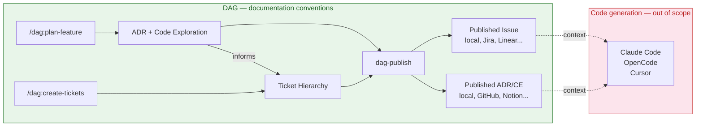

# Docs Augmented Generation (DAG)

📝✨ → 🤖🎯

The context you need for good code generation exists — it's just not documented. It's in your head, in conversations you've already had, in decisions you've already made. DAG is built for that gap.

**Documentation hygiene → code generation accuracy.** Structured documents like ADRs, code explorations, and decision logs get injected as context for higher-quality code generation. Your docs are the prompt — every decision preserved, every generation informed.

DAG parallels RAG: instead of retrieving arbitrary text chunks via semantic similarity, it injects curated, structured documentation as context for code generation. The goal is that every generation respects prior architectural decisions and preserves engineering context.

This project provides **Claude Code / OpenCode plugins** that implement the DAG documentation conventions.

## Plugin

| Plugin | What it gives you |
|--------|-------------------|
| [dag](plugins/dag/README.md) | Plan features (ADR + code exploration), break into tickets, publish to configured adapters |



## Quickstart

### 1. Clone

```bash
git clone <repo-url>
cd docs-augmented-generation
```

### 2. Configure adapters

`.dag/config.json` is required — it tells the pipeline where to publish documents and tickets. Two adapter categories, each independently configured:

| Adapter | What it routes | Required? |
|---------|---------------|-----------|
| `documentation` | ADRs, code explorations | yes |
| `issue-tracking` | Tickets (epics, stories, tasks, bugs, spikes) | yes |

Each adapter has a `type` field that selects the backend. The built-in `local` adapter writes to the filesystem at the paths you specify.

Run the init script to scaffold `.dag/config.json` interactively:

```bash
bash plugins/dag/scripts/dag-init.sh
```

The script prompts for paths with sensible defaults and writes the config atomically.

Fields for the `local` adapter (defaults shown):

| Field | Meaning | Default |
|-------|---------|---------|
| `adrPath` | Where ADRs and code explorations land. Each gets a date-prefixed filename like `2026-05-14-add-auth.md`. | `./.dag/docs/adr` |
| `project` | Ticket ID prefix used by the local adapter (produces IDs like `PROJ-1`). Uppercased, max 10 chars. | `PROJ` |
| `ticketPath` | Path to the ticket file directory. | `./.dag/docs/tickets` |

All paths are relative to the project root. The `parent` field in published documents creates subdirectories for grouping related docs.

### 3. Claude Code

#### Marketplace (recommended)

```
/plugin marketplace add mbaquerizo/docs-augmented-generation
/plugin install dag@docs-augmented-generation
```

#### Clone & run

```bash
claude --plugin-dir ./plugins/dag
```

### 4. Opencode

```bash
npx skills add ./plugins
```

Alternatively, add a root `opencode.jsonc`:

```jsonc
{
  "$schema": "https://opencode.ai/config.json",
  "skills": {
    "paths": ["./plugins"]
  }
}
```

### 5. Verify

Start a session and try a slash command:

```
/dag:plan-feature Set up user authentication
```

The model should load the plan-feature skill and begin the planning workflow.

## Prerequisites

- `.dag/config.json` with adapter configuration

## Usage

Skills are invoked automatically by the model when a task matches their description, or explicitly by the user:

| Syntax | Example | Scope |
|--------|---------|-------|
| `/plugin:skill` | `/dag:plan-feature` | Any skill from any installed plugin |
| `@agent-name` | `@code-exploration` | Agent invoked in conversation |
| Auto-dispatch | — | Model matches task context to skill descriptions |

Slash commands (`/dag:plan-feature`, `/dag:create-tickets`) are available at any prompt.

## Project structure

```
.dag/
  config.json              # Adapter configuration
plugins/
  dag/                     # Plugin (skills + agents + publisher)
  adapter-*/               # Optional cloud adapter plugins (Jira, GitHub, etc.)
```
